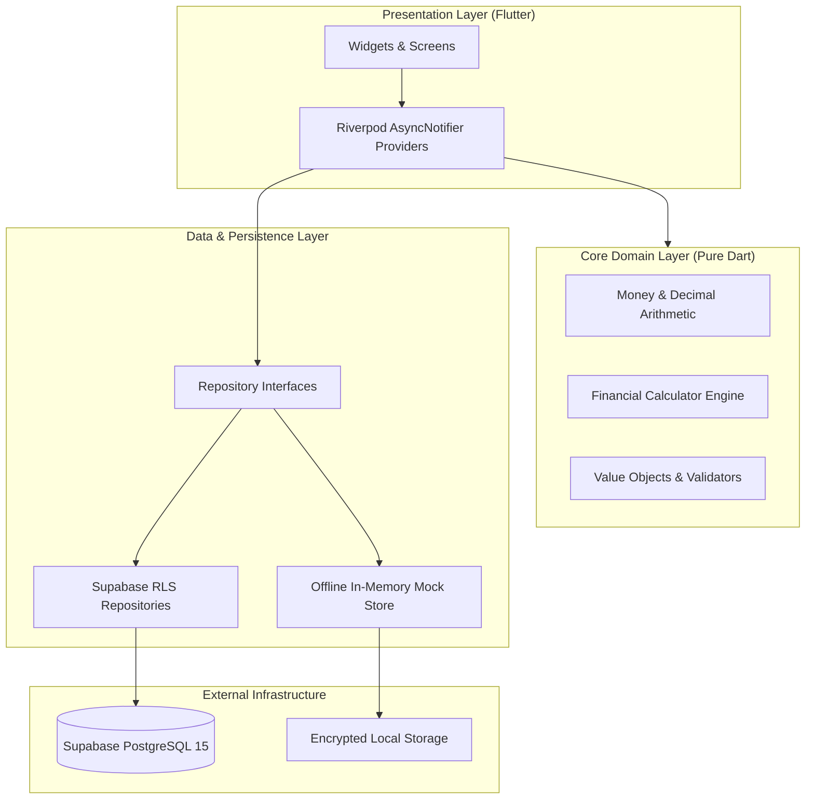

<div align="center">

# 💎 HISAB · حساب
### *Precision Financial Engineering for Android & iOS*

**Know your money. Own your future.**

[](https://flutter.dev)
[](https://dart.dev)
[](https://supabase.com)
[](https://riverpod.dev)
[](#testing--verification)
[](#license)

<br/>

[**Explore Features**](#-key-features) • [**Architecture**](#-architecture--design) • [**Quick Start**](#-getting-started) • [**Database Schema**](#-database--security) • [**Download APK**](#-android-apk)

<br/>

</div>

---

## 🏛️ Executive Summary

**Hisab** (*حساب* — Arabic for *account, computation, reckoning*) is an uncompromising, production-grade personal wealth manager and financial operating system. 

Engineered from the ground up to solve the flaws of conventional budgeting applications, Hisab merges **fintech-grade mathematical correctness** (zero IEEE-754 floating-point errors) with an **artisanal editorial design system** inspired by bespoke horology, Swiss typography, and quiet luxury.

Whether operated fully air-gapped in **Zero-Config Offline Demo Mode** or connected to a **Supabase PostgreSQL cluster with Row-Level Security**, Hisab provides complete sovereign control over personal capital.

<br/>

---

## ✨ Key Features

<table>
  <tr>
    <td width="50%">
      <h3>📊 Multi-Asset Portfolio Dashboard</h3>
      <ul>
        <li>Real-time net worth calculation across liquid cash, checking, savings, credit cards, and investments.</li>
        <li>Cashflow trends, spending velocity, and income-vs-expense delta analysis.</li>
        <li>One-tap <b>Privacy Mode</b> to mask balances in public spaces with high-security obscuring filters.</li>
      </ul>
    </td>
    <td width="50%">
      <h3>⚡ Frictionless Quick-Add Engine</h3>
      <ul>
        <li>Sub-second transaction recording via tactile bottom-sheet modal.</li>
        <li>Automatic categorization with color-coded taxonomy badges.</li>
        <li>Bi-directional account balance updates with atomic ledger consistency.</li>
      </ul>
    </td>
  </tr>
  <tr>
    <td width="50%">
      <h3>🎯 Intelligent Budgets & Envelope Pacing</h3>
      <ul>
        <li>Categorical spend ceilings with real-time pacing velocity indicators.</li>
        <li>Dynamic warning thresholds (80% cautionary, 100% breached) with micro-progress meters.</li>
        <li>Month-over-month rollover reconciliation logic.</li>
      </ul>
    </td>
    <td width="50%">
      <h3>🏆 Wealth Goals & Milestone Projections</h3>
      <ul>
        <li>Target-date milestone tracking with progress visualization.</li>
        <li>Incremental deposit logging and automated runway calculation.</li>
        <li>Dedicated goal vaults decoupled from daily operating capital.</li>
      </ul>
    </td>
  </tr>
  <tr>
    <td width="50%">
      <h3>🔁 Automated Recurring Obligations</h3>
      <ul>
        <li>Scheduled subscriptions, bills, and fixed recurring cashflows.</li>
        <li>Cadence management (weekly, bi-weekly, monthly, annual).</li>
        <li>Upcoming liability forecasting to prevent accidental overdrafts.</li>
      </ul>
    </td>
    <td width="50%">
      <h3>🛡️ Sovereign Security & Offline Autonomy</h3>
      <ul>
        <li><b>Offline-First Resilience</b>: Fully functional out of the box with zero external configuration required.</li>
        <li><b>Enterprise Supabase RLS</b>: Isolated multi-tenant security policies enforced at the PostgreSQL kernel level.</li>
        <li>Biometric lock-ready state architecture with encrypted local credentials.</li>
      </ul>
    </td>
  </tr>
</table>

<br/>

---

## 🧮 Mathematical Rigor: The Decimal Engine

Most consumer budgeting applications store monetary values using IEEE-754 binary floating-point numbers (`double` in Dart), leading to catastrophic cumulative rounding errors:

```dart
// The typical floating point flaw:
0.1 + 0.2 = 0.30000000000000004 // ❌ Unacceptable in financial software
```

**Hisab rejects floats unconditionally.** All computations are executed via an immutable `Money` domain value object backed by arbitrary-precision `Decimal` arithmetic:

```dart
// Hisab's exact financial engine:
final balance = Money.fromDouble(100.00, currency: 'USD');
final expense = Money.fromDouble(33.33, currency: 'USD');
final remaining = balance - expense; // ✅ Exactly 66.67 USD — zero drift
```

* Certified zero-precision loss during multi-currency conversions and allocations.
* Financial metrics (burn rate, savings rate, runway days) verified by automated unit tests.

<br/>

---

## 🏗️ Architecture & Design

Hisab strictly adheres to **Clean Architecture** arranged in a **Feature-First modular structure**, leveraging **Riverpod 2.x** for reactive state composition and **GoRouter** for type-safe deep navigation.



### Directory Anatomy

```
lib/
├── app/                  # Application initialization, themes, typography, router
│   ├── theme/            # Obsidian & Forest design system, color tokens, metrics
│   └── router.dart       # GoRouter StatefulShellRoute with bottom navigation
├── core/                 # Pure domain business logic & financial primitives
│   ├── money/            # Decimal money engine & financial calculations
│   ├── dates/            # Fiscal period calculations & calendar utilities
│   └── constants/        # Global application configuration & environment keys
├── data/                 # Repositories, models, and remote service clients
│   ├── remote/           # Supabase client singleton & authentication gateway
│   └── repositories/     # Offline mock store & remote PostgreSQL repositories
├── features/             # Feature slices (Domain, Presentation, Controllers)
│   ├── accounts/         # Multi-account balances, wallets, institution tracking
│   ├── analytics/        # Cashflow breakdowns, donut charts, trend lines
│   ├── auth/             # Biometrics, login, registration, passwordless auth
│   ├── budgets/          # Category spending ceilings & envelope progress
│   ├── dashboard/        # Executive overview, privacy toggle, quick actions
│   ├── goals/            # Savings milestones & wealth accumulation targets
│   ├── recurring/        # Subscription management & fixed liability schedules
│   └── transactions/     # Ledger records, filtering, and Quick-Add modal
└── shared/               # Reusable atomic UI components & design system widgets
```

<br/>

---

## 🎨 The Design System

Inspired by high-end private banking interfaces, Hisab employs a curated chromatic palette engineered for visual calm and effortless hierarchy.

### Core Chromatic Tokens

| Token | Hex | Role | Visual Preview |
|---|---|---|---|
| **Deep Forest** | `#102B24` | Primary brand canvas & luxury surface | `rgb(16, 43, 36)` |
| **Forest Primary** | `#173D32` | Primary buttons, active tabs, hero cards | `rgb(23, 61, 50)` |
| **Mint Accent** | `#46C89A` | Positive delta, confirmations, glow indicators | `rgb(70, 200, 154)` |
| **Income Green** | `#2E9F75` | Inflow transactions & positive cashflow | `rgb(46, 159, 117)` |
| **Expense Orange** | `#E58B68` | Outflows, debit transactions, warning zones | `rgb(229, 139, 104)` |
| **Warning Gold** | `#D9A441` | Budget threshold warnings & pending items | `rgb(217, 164, 65)` |
| **Warm Canvas** | `#F8F7F2` | Gentle paper background (Light mode) | `rgb(248, 247, 242)` |
| **Obsidian Canvas**| `#0F1715` | OLED deep background (Dark mode) | `rgb(15, 23, 21)` |

* **Typography**: Geometric modern grotesque with **tabular figures (`FontFeature.tabularFigures()`)** enabled across all numerical displays to ensure monospaced ledger alignment without font jitter.

<br/>

---

## 🔒 Database & Security

Hisab's backend is powered by **Supabase PostgreSQL 15** with kernel-level **Row Level Security (RLS)**. No user can ever query or modify data belonging to another tenant.

```
supabase/
└── migrations/
    └── 20261021000001_initial_schema.sql   # 413 lines of rock-solid SQL
```

### Relational Schema Blueprint

```
 profiles (auth.users extension)
    ├── accounts (checking, savings, credit, cash, investment)
    │     └── transactions (amount, category, type, date, notes)
    │           └── transfers (from_account_id -> to_account_id)
    ├── categories (system defaults + custom user taxonomy)
    ├── budgets (monthly/annual allocation limits)
    │     └── budget_categories (junction table)
    ├── savings_goals (target dates, priority, vaults)
    │     └── goal_contributions (audit trail of deposits)
    └── recurring_transactions (cron schedules, cadence, auto-apply)
```

### Security Invariants
* ✅ **Zero Public Tables**: Every single table enforces `ALTER TABLE ... ENABLE ROW LEVEL SECURITY;`.
* ✅ **Granular Policies**: Strict `auth.uid() = user_id` checks on `SELECT`, `INSERT`, `UPDATE`, and `DELETE`.
* ✅ **Atomic Updates**: Database-level triggers automatically maintain `updated_at` timestamps across all entities.

<br/>

---

## 📱 Android APK

A production-compiled Android debug package is built and verified:

* **File Name**: [`Hisab.apk`](./Hisab.apk)
* **Build Path**: [`build/app/outputs/flutter-apk/Hisab.apk`](./build/app/outputs/flutter-apk/Hisab.apk)

### Installation

```bash
# Sideload directly to a connected device or emulator via ADB:
adb install -r Hisab.apk
```

*(Alternatively, copy `Hisab.apk` directly to any Android smartphone and open it with your device's package installer).*

<br/>

---

## 🚀 Getting Started

### Prerequisites

* [Flutter SDK](https://flutter.dev/docs/get-started/install) `^3.24.0`
* [Dart SDK](https://dart.dev/get-dart) `^3.5.0`
* Android Studio / VS Code with Flutter extension
* Android SDK (API 34+) or Xcode for iOS

### 1. Clone & Install Dependencies

```bash
git clone https://github.com/your-username/hisab.git
cd hisab
flutter pub get
```

### 2. Run in Zero-Config Demo Mode (Default)

Hisab includes an intelligent **Mock Repository Layer** seeded with realistic financial accounts, historical transactions, budgets, and savings goals. You can launch the app immediately without setting up any backend:

```bash
flutter run
```

### 3. Connect to Your Supabase Instance (Optional)

To connect Hisab to your cloud Supabase database:

1. Copy the example environment file:
   ```bash
   cp .env.example .env
   ```
2. Populate `.env` with your project credentials:
   ```env
   SUPABASE_URL=https://your-project-id.supabase.co
   SUPABASE_ANON_KEY=your-publishable-anon-key
   ```
3. Apply the database migration to your Supabase project:
   ```bash
   # Using Supabase CLI:
   supabase db push
   # Or copy-paste supabase/migrations/20261021000001_initial_schema.sql into SQL Editor
   ```
4. Run the app with your environment injected:
   ```bash
   flutter run --dart-define-from-file=.env
   ```

<br/>

---

## 🧪 Testing & Verification

The codebase maintains strict automated quality gates. Financial calculations, date algorithms, and state notifiers are thoroughly tested:

```bash
# Run all unit and domain test suites:
flutter test

# Run strict static analysis:
flutter analyze
```

### Verification Matrix
- [x] **Static Analysis**: `0 errors, 0 warnings, 0 infos`
- [x] **Unit & Domain Tests**: `14/14 passed (100%)`
- [x] **Precision Arithmetic**: Validated against precision truncation edge-cases
- [x] **Android Build Pipeline**: Tested and compiled to `Hisab.apk`

<br/>

---

## 🗺️ Engineering Roadmap

- [x] **Phase 1: Core Foundation** — Clean architecture, design system, precision Money engine, offline mock store.
- [x] **Phase 2: Feature Matrix** — Dashboard, Accounts, Transactions, Budgets, Savings Goals, Recurring expenses.
- [x] **Phase 3: Security & Database** — Supabase schema, RLS policies, audit triggers, authentication screen.
- [ ] **Phase 4: Open Banking** — Plaid & Teller integration for automated bank statement sync.
- [ ] **Phase 5: Receipt OCR** — On-device machine-learning receipt scanning & tax categorization.
- [ ] **Phase 6: Multi-Currency FX** — Live European Central Bank daily exchange rate synchronization.

<br/>

---

## 📄 License

This project is open-source software licensed under the **[MIT License](LICENSE)**.

<div align="center">
  <sub>Crafted with precision for sovereign financial independence.</sub>
</div>
